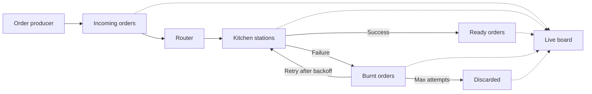

# Chaotic Kitchen

A Kafka hobby project: a chaotic restaurant kitchen.

Orders stream in on Kafka. A router sends them to grill / drinks / dessert stations.
Stations sometimes burn food → **dead-letter topic**. A retryer requeues with backoff
(or discards after max attempts). A live board shows the madness.

Useful for learning: topics, producers, consumers, consumer groups, keys, DLQ.

## Tech stack

- Apache Kafka 4.3.1 (Docker, KRaft)
- Python 3.12
- `confluent-kafka` 2.15.1
- FastAPI + Uvicorn (local web board)
- Prometheus + Grafana (optional ops dashboards)

## Architecture



Solid arrows = order path. Dotted arrows = live board observing. Stations = grill / drinks / dessert.

## Topics

| Topic | Role |
|--------|------|
| `orders.incoming` | New orders |
| `station.grill` | Hot food |
| `station.drinks` | Drinks |
| `station.dessert` | Desserts |
| `orders.ready` | Completed |
| `orders.burnt` | Dead-letter (failures, retried) |
| `orders.discarded` | Gave up after max attempts / poison |

## Setup

```bash
cd /path/to/chaotic-kitchen
python3 -m venv .venv
source .venv/bin/activate
pip install -r requirements.txt
docker compose up -d
```

Wait until Kafka is healthy and `init-topics` finishes (`docker compose ps`).

If Kafka was already running from an older checkout, recreate topics:

```bash
docker compose up init-topics
```

## Run

Start order: Kafka → kitchen (+ web board) → producer.

```bash
source .venv/bin/activate

# Terminal 1 — router, stations, retry, web board → http://127.0.0.1:8000
python run_kitchen.py

# Terminal 2 — flood the kitchen (orders per second)
python producer/main.py 2
```

Open http://127.0.0.1:8000 in your browser after the kitchen starts.
Use `--no-web` for workers only.

The board shows counts, recent events, and a **Place order** button
(sends one message to `orders.incoming`; works with or without the flood producer).

Optional ASCII board (uses its own consumer group; can run beside the web board):

```bash
python board/main.py
```

Turn up the producer rate (`5`, `10`, …) and watch grill lag / burns climb.

## Ops dashboards (Prometheus + Grafana)

`docker compose up -d` also starts Kafka exporter, Prometheus, and Grafana.

| UI | URL |
|----|-----|
| Web board | http://127.0.0.1:8000 |
| Grafana | http://127.0.0.1:3000 (anonymous viewer, or `admin` / `admin`) |
| Prometheus | http://127.0.0.1:9090 |

Open the **Chaotic Kitchen** dashboard in Grafana for event rates, burn share, and consumer lag.

App metrics are scraped from the host web board (`/metrics`). Keep `run_kitchen.py` (or `python web/main.py`) running so those series stay fresh. Lag comes from `kafka-exporter` inside Compose.

## Optional: inspect topics

```bash
# list topics
docker exec -it chaotic-kitchen-kafka \
  /opt/kafka/bin/kafka-topics.sh \
  --bootstrap-server localhost:9092 \
  --list

# consume from the beginning (Ctrl+C to stop)
docker exec -it chaotic-kitchen-kafka \
  /opt/kafka/bin/kafka-console-consumer.sh \
  --bootstrap-server localhost:9092 \
  --topic orders.incoming \
  --from-beginning \
  --property print.key=true \
  --property key.separator=" | "
```

Swap `orders.incoming` for `station.grill`, `orders.ready`, `orders.burnt`, `orders.discarded`, etc.

## Stop

```bash
docker compose down -v
```

## Concepts covered

- Event-driven pipeline with multiple consumer groups
- Partition key = `order_id` (ordering per order)
- Dead-letter topic with retry and a final discard topic
- Backoff before retry — without a pause, burnt orders can loop `burnt → station → burnt` and flood the system
- Backpressure / lag visible when grill is slower than intake
- Prometheus metrics + Grafana for rates, burn share, and consumer lag
